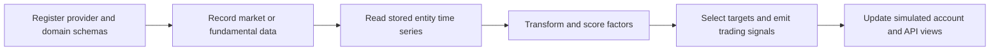
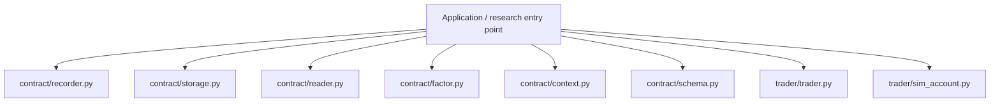
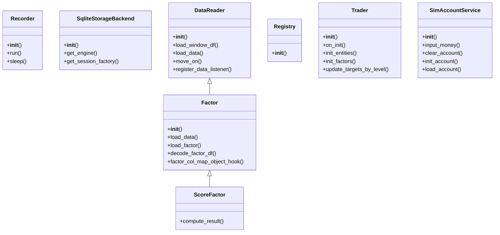
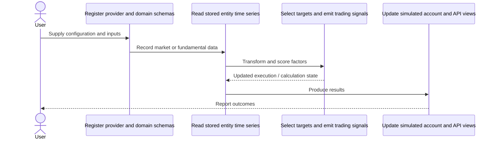
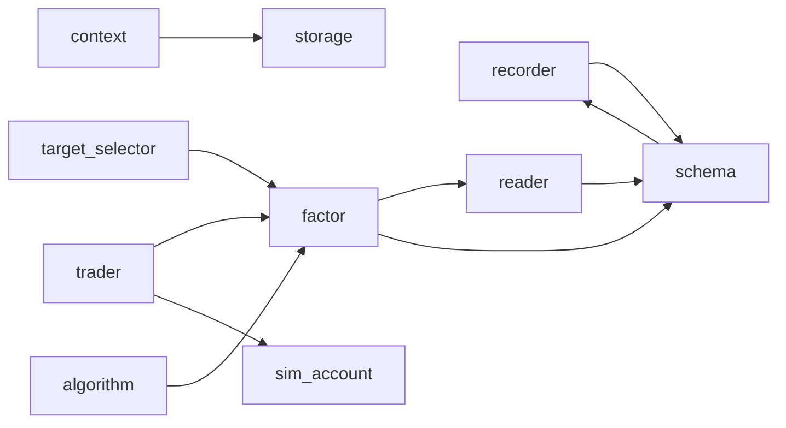
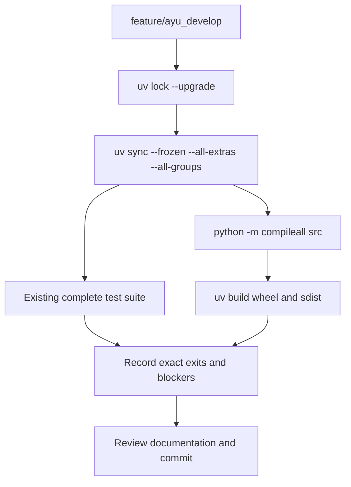

# zvt: development, architecture and operations

Updated 2026-10-12 on `feature/ayu_develop`; source snapshot `e395b107a905`. This guide follows the source in this checkout and separates available interfaces from verification evidence.

## Purpose and feature boundaries

A modular data recording, storage, factor research and trading framework with SQLAlchemy domain schemas, registry contracts, API services and simulated accounts.

Domain schemas define entities and observations; recorder classes own ingestion and resume state. Storage and registry contracts choose backends/providers. DataReader supplies history to transform/accumulate/score factors, TargetSelector chooses instruments, and Trader coordinates account actions. FastAPI and Dash expose data and research views; provider-dependent tests need local data and service configuration.

## Main workflow

The following is the repository-specific logical workflow. Runtime execution details remain in the linked source and the validation record.

1. Register provider and domain schemas.
2. Record market or fundamental data.
3. Read stored entity time series.
4. Transform and score factors.
5. Select targets and emit trading signals.
6. Update simulated account and API views.

## Components and ownership

The entry point composes the source modules below; arrows indicate review/navigation boundaries rather than a claim that every module is called in every run.

| Source | Declared classes / functions | Implementation role |
|---|---|---|
| [src/zvt/contract/recorder.py](../src/zvt/contract/recorder.py) | Meta, Recorder, EntityEventRecorder, TimeSeriesDataRecorder, FixedCycleDataRecorder, TimestampsDataRecorder; _register_kdata_schemas_for_recorder | See the public declarations and implementation linked here. |
| [src/zvt/contract/storage.py](../src/zvt/contract/storage.py) | StorageBackend, SqliteStorageBackend; _default_data_path, _get_storage_config, get_storage_backend, set_storage_backend | Storage abstraction for ZVT. |
| [src/zvt/contract/reader.py](../src/zvt/contract/reader.py) | DataListener, DataReader | See the public declarations and implementation linked here. |
| [src/zvt/contract/factor.py](../src/zvt/contract/factor.py) | TargetType, Indicator, Transformer, Accumulator, Scorer, FactorMeta; _register_class | See the public declarations and implementation linked here. |
| [src/zvt/contract/context.py](../src/zvt/contract/context.py) | Registry | ZVT global context. Phase 1: storage_backend and route_registry are optional |
| [src/zvt/contract/schema.py](../src/zvt/contract/schema.py) | Mixin, NormalMixin, Entity, TradableEntity, ActorEntity, NormalEntityMixin; _get_schema_providers | See the public declarations and implementation linked here. |
| [src/zvt/trader/trader.py](../src/zvt/trader/trader.py) | Trader, StockTrader | See the public declarations and implementation linked here. |
| [src/zvt/trader/sim_account.py](../src/zvt/trader/sim_account.py) | SimAccountService | See the public declarations and implementation linked here. |
| [src/zvt/factors/target_selector.py](../src/zvt/factors/target_selector.py) | TradeType, SelectMode, TargetSelector | See the public declarations and implementation linked here. |
| [src/zvt/factors/algorithm.py](../src/zvt/factors/algorithm.py) | RankScorer, MaTransformer, IntersectTransformer, MaAndVolumeTransformer, MacdTransformer, QuantileScorer; ma, ema, live_or_dead, macd | See the public declarations and implementation linked here. |
| [src/zvt/domain/meta/stock_meta.py](../src/zvt/domain/meta/stock_meta.py) | Stock, StockDetail | See the public declarations and implementation linked here. |
| [src/zvt/zvt_server.py](../src/zvt/zvt_server.py) | root, main | See the public declarations and implementation linked here. |
| [src/zvt/main.py](../src/zvt/main.py) | serve_layout, tab_content, main | See the public declarations and implementation linked here. |
| [src/zvt/__init__.py](../src/zvt/__init__.py) | init_log, init_env, init_resources, init_config | See the public declarations and implementation linked here. |

## Class design

Methods and inheritance edges are taken from the selected declarations in the actual source. A missing edge means composition or an external base is not asserted here.

## End-to-end interaction

This sequence presents the responsibilities of the main workflow, including the state/result boundary. The linked classes and functions provide the exact method-level contract.

## Source dependency direction

These edges are actual explicit imports between the selected source modules. Dynamic imports, re-exports and third-party internals are omitted.

## Design details and extension points

### `Recorder`

Source: [src/zvt/contract/recorder.py](../src/zvt/contract/recorder.py).

The class contract is defined by its linked implementation.

- `run`: See implementation for the complete contract.
- `sleep`: See implementation for the complete contract.

### `SqliteStorageBackend`

Source: [src/zvt/contract/storage.py](../src/zvt/contract/storage.py).

SQLite storage backend. Default path: {data_path}/{provider}/{provider}_{db_name}.db
Config (zvt_config["storage"]):
  - base_path: override data path
  - path_template: format string with {base_path}, {provider}, {db_name}, {storage_id}

- `get_engine`: See implementation for the complete contract.
- `get_session_factory`: See implementation for the complete contract.

### `DataReader`

Source: [src/zvt/contract/reader.py](../src/zvt/contract/reader.py).

The class contract is defined by its linked implementation.

- `load_window_df`: See implementation for the complete contract.
- `load_data`: See implementation for the complete contract.
- `move_on`: using continual fetching data in realtime 1)get the data happened before to_timestamp,if not set,get all the data which means to now 2)if computing_window set,the data_df would be cut for saving memory
- `register_data_listener`: See implementation for the complete contract.
- `deregister_data_listener`: See implementation for the complete contract.

### `Factor`

Source: [src/zvt/contract/factor.py](../src/zvt/contract/factor.py).

The class contract is defined by its linked implementation.

- `load_data`: See implementation for the complete contract.
- `load_factor`: See implementation for the complete contract.
- `decode_factor_df`: See implementation for the complete contract.
- `factor_col_map_object_hook`: :return:{col:object_hook}
- `clear_state_data`: See implementation for the complete contract.

### `ScoreFactor`

Source: [src/zvt/contract/factor.py](../src/zvt/contract/factor.py).

The class contract is defined by its linked implementation.

- `compute_result`: See implementation for the complete contract.

### `Registry`

Source: [src/zvt/contract/context.py](../src/zvt/contract/context.py).

Class storing zvt registering meta

### `Trader`

Source: [src/zvt/trader/trader.py](../src/zvt/trader/trader.py).

The class contract is defined by its linked implementation.

- `on_init`: See implementation for the complete contract.
- `init_entities`: init the entities for timestamp
- `init_factors`: overwrite it to init factors if you want to use factor computing model :param adjust_type:
- `update_targets_by_level`: the trading signals is generated in min level,before that,we should cache targets of all levels
- `get_long_targets_by_level`: See implementation for the complete contract.

### `SimAccountService`

Source: [src/zvt/trader/sim_account.py](../src/zvt/trader/sim_account.py).

The class contract is defined by its linked implementation.

- `input_money`: See implementation for the complete contract.
- `clear_account`: See implementation for the complete contract.
- `init_account`: See implementation for the complete contract.
- `load_account`: See implementation for the complete contract.
- `on_trading_open`: See implementation for the complete contract.

## Repository layout and resources

Installable packages live under `src/`. `pyproject.toml` defines package metadata, build requirements, optional integrations and development dependencies; `uv.lock` records resolved versions, and `.python-version` selects the local interpreter. This layout keeps an accidental checkout import from substituting for the installed wheel. Package resources remain beside their owning modules and are included by the build backend. Existing upstream examples, fixtures, scripts and documentation retain their separate roles.

## Maintenance compatibility and evidence

- The full supplied suite includes historical-provider, data-recorder, chart and trader integration cases and is executed without exclusions.
- Production code uses SQLAlchemy2 declarative_base/Session.get, pandas iloc for positional access, current hour/day/month frequencies, and ISO-date JSON logging. Tests and public data-provider APIs remain intact.
- Live recorder cases require authenticated JoinQuant/provider access and populated historical/test databases; evidence identifies remaining environmental and implementation failures separately.

## Development and verification workflow

See [development commands](development.md) and [validation evidence](validation.md) for interpreter selection, dependency exceptions, full-suite results and remaining blockers. No additional test cases were introduced by this maintenance.
