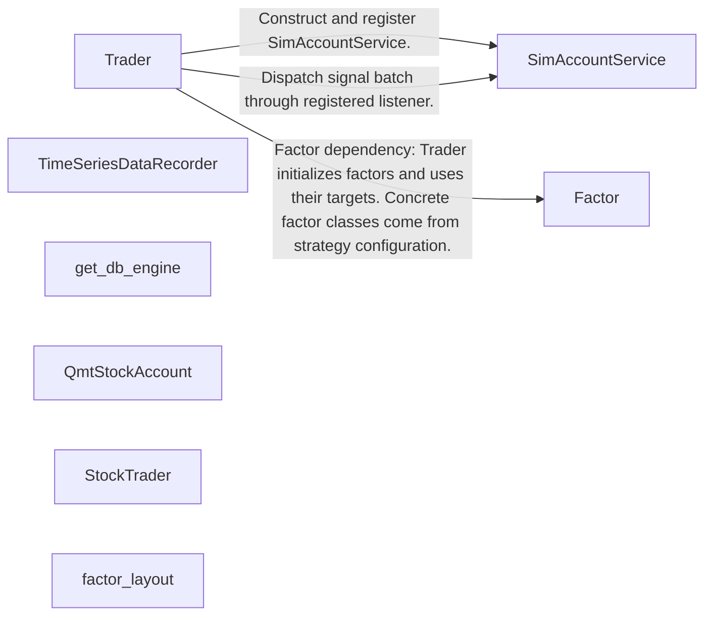
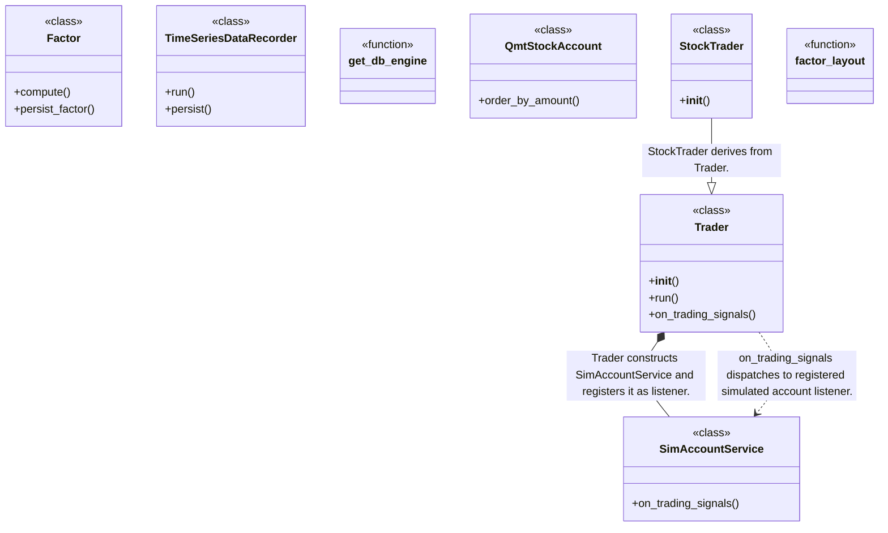
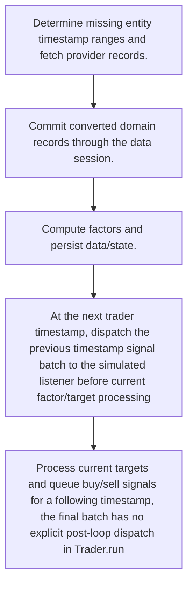
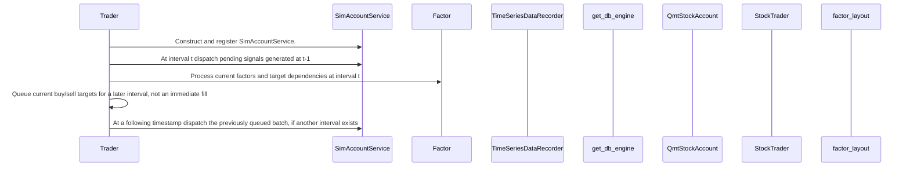

# ZVT: workflow, design and architecture

Updated: **2026-10-13**
Reviewed Git hash: `85e215aa7abd2093ea7fde1a00378c13f473641f`
Branch: `feature/ayu_develop`
Source diff SHA256: `e3b0c44298fc1c149afbf4c8996fb92427ae41e4649b934ca495991b7852b855`
Scope: **Schema-based market data and factor research framework** / Maintenance: **active**
Languages: Python

[HTML edition](ayu-develop.html) / [Development](development.md) / [Historical validation](validation.md) / [Full system comparison](../../docs/index.html)

## Purpose and scope

Record provider data into routed storage, compute persistent factors and drive simulated trading signals, with a separate QMT stock-account adapter.

## Features and support boundaries

Native = implemented here. Integration = supplied through a named host/API. Limited = material restriction. Not provided = evidenced scope exclusion. Unverified = support/absence not established. Not applicable = outside this artifact type.

| Capability | Status | Implementation and limits | Source |
|---|---|---|---|
| Backtesting | Native | Trader runs interval timestamps using default SimAccountService. | [Trader.__init__](../src/zvt/trader/trader.py) ([L29](https://github.com/alexcwyu/zvt/blob/85e215aa7abd2093ea7fde1a00378c13f473641f/src/zvt/trader/trader.py#L29)) / [Trader.run](../src/zvt/trader/trader.py) ([L434](https://github.com/alexcwyu/zvt/blob/85e215aa7abd2093ea7fde1a00378c13f473641f/src/zvt/trader/trader.py#L434)) / [Trader.on_trading_signals](../src/zvt/trader/trader.py) ([L364](https://github.com/alexcwyu/zvt/blob/85e215aa7abd2093ea7fde1a00378c13f473641f/src/zvt/trader/trader.py#L364)) / [SimAccountService.on_trading_signals](../src/zvt/trader/sim_account.py) ([L161](https://github.com/alexcwyu/zvt/blob/85e215aa7abd2093ea7fde1a00378c13f473641f/src/zvt/trader/sim_account.py#L161)) |
| Live execution | Integration | Separate QmtStockAccount adapter calls xt_trader.order_stock. Default Trader uses SimAccountService. | [Trader.__init__](../src/zvt/trader/trader.py) ([L29](https://github.com/alexcwyu/zvt/blob/85e215aa7abd2093ea7fde1a00378c13f473641f/src/zvt/trader/trader.py#L29)) / [Trader.run](../src/zvt/trader/trader.py) ([L434](https://github.com/alexcwyu/zvt/blob/85e215aa7abd2093ea7fde1a00378c13f473641f/src/zvt/trader/trader.py#L434)) / [Trader.on_trading_signals](../src/zvt/trader/trader.py) ([L364](https://github.com/alexcwyu/zvt/blob/85e215aa7abd2093ea7fde1a00378c13f473641f/src/zvt/trader/trader.py#L364)) / [QmtStockAccount.order_by_amount](../src/zvt/broker/qmt/qmt_account.py) ([L154](https://github.com/alexcwyu/zvt/blob/85e215aa7abd2093ea7fde1a00378c13f473641f/src/zvt/broker/qmt/qmt_account.py#L154)) |
| Paper trading | Limited | Default account is simulated. real_time affects waiting/data synchronization and does not switch account to live. | [Trader.__init__](../src/zvt/trader/trader.py) ([L29](https://github.com/alexcwyu/zvt/blob/85e215aa7abd2093ea7fde1a00378c13f473641f/src/zvt/trader/trader.py#L29)) / [Trader.run](../src/zvt/trader/trader.py) ([L434](https://github.com/alexcwyu/zvt/blob/85e215aa7abd2093ea7fde1a00378c13f473641f/src/zvt/trader/trader.py#L434)) / [Trader.on_trading_signals](../src/zvt/trader/trader.py) ([L364](https://github.com/alexcwyu/zvt/blob/85e215aa7abd2093ea7fde1a00378c13f473641f/src/zvt/trader/trader.py#L364)) |
| Event driven | Native | Interval callbacks dispatch TradingSignal batches to registered listeners. | [Trader.__init__](../src/zvt/trader/trader.py) ([L29](https://github.com/alexcwyu/zvt/blob/85e215aa7abd2093ea7fde1a00378c13f473641f/src/zvt/trader/trader.py#L29)) / [Trader.run](../src/zvt/trader/trader.py) ([L434](https://github.com/alexcwyu/zvt/blob/85e215aa7abd2093ea7fde1a00378c13f473641f/src/zvt/trader/trader.py#L434)) / [Trader.on_trading_signals](../src/zvt/trader/trader.py) ([L364](https://github.com/alexcwyu/zvt/blob/85e215aa7abd2093ea7fde1a00378c13f473641f/src/zvt/trader/trader.py#L364)) |
| Vectorized | Unverified | The inspected source does not establish this capability. This is not a claim of absence. | Not applicable to this repository scope. |
| Order management | Limited | Signal-driven simulated account plus separate QMT order submission. Full live order reconciliation was not inspected. | [SimAccountService.on_trading_signals](../src/zvt/trader/sim_account.py) ([L161](https://github.com/alexcwyu/zvt/blob/85e215aa7abd2093ea7fde1a00378c13f473641f/src/zvt/trader/sim_account.py#L161)) / [QmtStockAccount.order_by_amount](../src/zvt/broker/qmt/qmt_account.py) ([L154](https://github.com/alexcwyu/zvt/blob/85e215aa7abd2093ea7fde1a00378c13f473641f/src/zvt/broker/qmt/qmt_account.py#L154)) |
| Order types | Limited | QMT adapter submits fixed-price stock orders. Other native venue types were not substantiated. | [QmtStockAccount.order_by_amount](../src/zvt/broker/qmt/qmt_account.py) ([L154](https://github.com/alexcwyu/zvt/blob/85e215aa7abd2093ea7fde1a00378c13f473641f/src/zvt/broker/qmt/qmt_account.py#L154)) |
| Multi venue | Unverified | The inspected source does not establish this capability. This is not a claim of absence. | Not applicable to this repository scope. |
| Crypto | Unverified | The inspected source does not establish this capability. This is not a claim of absence. | Not applicable to this repository scope. |
| Equities | Native | StockTrader and QMT stock-account integration. | [QmtStockAccount.order_by_amount](../src/zvt/broker/qmt/qmt_account.py) ([L154](https://github.com/alexcwyu/zvt/blob/85e215aa7abd2093ea7fde1a00378c13f473641f/src/zvt/broker/qmt/qmt_account.py#L154)) / [StockTrader.__init__](../src/zvt/trader/trader.py) ([L538](https://github.com/alexcwyu/zvt/blob/85e215aa7abd2093ea7fde1a00378c13f473641f/src/zvt/trader/trader.py#L538)) |
| Futures | Unverified | The inspected source does not establish this capability. This is not a claim of absence. | Not applicable to this repository scope. |
| Options | Unverified | The inspected source does not establish this capability. This is not a claim of absence. | Not applicable to this repository scope. |
| Forex | Unverified | The inspected source does not establish this capability. This is not a claim of absence. | Not applicable to this repository scope. |
| Strategy api | Native | Trader hooks initialize factors and select targets, buy/sell and notify listeners. | [Trader.__init__](../src/zvt/trader/trader.py) ([L29](https://github.com/alexcwyu/zvt/blob/85e215aa7abd2093ea7fde1a00378c13f473641f/src/zvt/trader/trader.py#L29)) / [Trader.run](../src/zvt/trader/trader.py) ([L434](https://github.com/alexcwyu/zvt/blob/85e215aa7abd2093ea7fde1a00378c13f473641f/src/zvt/trader/trader.py#L434)) / [Trader.on_trading_signals](../src/zvt/trader/trader.py) ([L364](https://github.com/alexcwyu/zvt/blob/85e215aa7abd2093ea7fde1a00378c13f473641f/src/zvt/trader/trader.py#L364)) |
| Optimization | Unverified | The inspected source does not establish this capability. This is not a claim of absence. | Not applicable to this repository scope. |
| Machine learning | Unverified | The inspected source does not establish this capability. This is not a claim of absence. | Not applicable to this repository scope. |
| Reinforcement learning | Unverified | The inspected source does not establish this capability. This is not a claim of absence. | Not applicable to this repository scope. |
| Portfolio | Native | Simulated account listener processes trading signals and maintains the account workflow. | [Trader.__init__](../src/zvt/trader/trader.py) ([L29](https://github.com/alexcwyu/zvt/blob/85e215aa7abd2093ea7fde1a00378c13f473641f/src/zvt/trader/trader.py#L29)) / [Trader.run](../src/zvt/trader/trader.py) ([L434](https://github.com/alexcwyu/zvt/blob/85e215aa7abd2093ea7fde1a00378c13f473641f/src/zvt/trader/trader.py#L434)) / [Trader.on_trading_signals](../src/zvt/trader/trader.py) ([L364](https://github.com/alexcwyu/zvt/blob/85e215aa7abd2093ea7fde1a00378c13f473641f/src/zvt/trader/trader.py#L364)) / [SimAccountService.on_trading_signals](../src/zvt/trader/sim_account.py) ([L161](https://github.com/alexcwyu/zvt/blob/85e215aa7abd2093ea7fde1a00378c13f473641f/src/zvt/trader/sim_account.py#L161)) |
| Risk management | Limited | Trader applies profit-control selection before issuing buy/sell signals. Concrete strategy limits are configurable. | [Trader.__init__](../src/zvt/trader/trader.py) ([L29](https://github.com/alexcwyu/zvt/blob/85e215aa7abd2093ea7fde1a00378c13f473641f/src/zvt/trader/trader.py#L29)) / [Trader.run](../src/zvt/trader/trader.py) ([L434](https://github.com/alexcwyu/zvt/blob/85e215aa7abd2093ea7fde1a00378c13f473641f/src/zvt/trader/trader.py#L434)) / [Trader.on_trading_signals](../src/zvt/trader/trader.py) ([L364](https://github.com/alexcwyu/zvt/blob/85e215aa7abd2093ea7fde1a00378c13f473641f/src/zvt/trader/trader.py#L364)) |
| Performance analytics | Unverified | The inspected source does not establish this capability. This is not a claim of absence. | Not applicable to this repository scope. |
| Historical data | Native | TimeSeriesDataRecorder fills missing entity history. | [TimeSeriesDataRecorder.run](../src/zvt/contract/recorder.py) ([L476](https://github.com/alexcwyu/zvt/blob/85e215aa7abd2093ea7fde1a00378c13f473641f/src/zvt/contract/recorder.py#L476)) / [TimeSeriesDataRecorder.persist](../src/zvt/contract/recorder.py) ([L433](https://github.com/alexcwyu/zvt/blob/85e215aa7abd2093ea7fde1a00378c13f473641f/src/zvt/contract/recorder.py#L433)) |
| Streaming data | Limited | Trader real_time waits for timestamps and factor updates. This is not proof of a websocket stream. | [Trader.__init__](../src/zvt/trader/trader.py) ([L29](https://github.com/alexcwyu/zvt/blob/85e215aa7abd2093ea7fde1a00378c13f473641f/src/zvt/trader/trader.py#L29)) / [Trader.run](../src/zvt/trader/trader.py) ([L434](https://github.com/alexcwyu/zvt/blob/85e215aa7abd2093ea7fde1a00378c13f473641f/src/zvt/trader/trader.py#L434)) / [Trader.on_trading_signals](../src/zvt/trader/trader.py) ([L364](https://github.com/alexcwyu/zvt/blob/85e215aa7abd2093ea7fde1a00378c13f473641f/src/zvt/trader/trader.py#L364)) |
| Persistence | Native | SQLAlchemy session commits, factor frame/state persistence and routed backend engine. | [Factor.compute](../src/zvt/contract/factor.py) ([L434](https://github.com/alexcwyu/zvt/blob/85e215aa7abd2093ea7fde1a00378c13f473641f/src/zvt/contract/factor.py#L434)) / [Factor.persist_factor](../src/zvt/contract/factor.py) ([L571](https://github.com/alexcwyu/zvt/blob/85e215aa7abd2093ea7fde1a00378c13f473641f/src/zvt/contract/factor.py#L571)) / [TimeSeriesDataRecorder.run](../src/zvt/contract/recorder.py) ([L476](https://github.com/alexcwyu/zvt/blob/85e215aa7abd2093ea7fde1a00378c13f473641f/src/zvt/contract/recorder.py#L476)) / [TimeSeriesDataRecorder.persist](../src/zvt/contract/recorder.py) ([L433](https://github.com/alexcwyu/zvt/blob/85e215aa7abd2093ea7fde1a00378c13f473641f/src/zvt/contract/recorder.py#L433)) / [get_db_engine](../src/zvt/contract/api.py) ([L49](https://github.com/alexcwyu/zvt/blob/85e215aa7abd2093ea7fde1a00378c13f473641f/src/zvt/contract/api.py#L49)) |
| Data pipeline | Native | Provider records map to domain objects, persistent factor compute and trader targets. | [Trader.__init__](../src/zvt/trader/trader.py) ([L29](https://github.com/alexcwyu/zvt/blob/85e215aa7abd2093ea7fde1a00378c13f473641f/src/zvt/trader/trader.py#L29)) / [Trader.run](../src/zvt/trader/trader.py) ([L434](https://github.com/alexcwyu/zvt/blob/85e215aa7abd2093ea7fde1a00378c13f473641f/src/zvt/trader/trader.py#L434)) / [Trader.on_trading_signals](../src/zvt/trader/trader.py) ([L364](https://github.com/alexcwyu/zvt/blob/85e215aa7abd2093ea7fde1a00378c13f473641f/src/zvt/trader/trader.py#L364)) / [Factor.compute](../src/zvt/contract/factor.py) ([L434](https://github.com/alexcwyu/zvt/blob/85e215aa7abd2093ea7fde1a00378c13f473641f/src/zvt/contract/factor.py#L434)) / [Factor.persist_factor](../src/zvt/contract/factor.py) ([L571](https://github.com/alexcwyu/zvt/blob/85e215aa7abd2093ea7fde1a00378c13f473641f/src/zvt/contract/factor.py#L571)) / [TimeSeriesDataRecorder.run](../src/zvt/contract/recorder.py) ([L476](https://github.com/alexcwyu/zvt/blob/85e215aa7abd2093ea7fde1a00378c13f473641f/src/zvt/contract/recorder.py#L476)) / [TimeSeriesDataRecorder.persist](../src/zvt/contract/recorder.py) ([L433](https://github.com/alexcwyu/zvt/blob/85e215aa7abd2093ea7fde1a00378c13f473641f/src/zvt/contract/recorder.py#L433)) |
| Web ui | Native | Bundled optional Dash factor layout exposes research controls and account/factor views. | [factor_layout](../src/zvt/ui/apps/factor_app.py) ([L63](https://github.com/alexcwyu/zvt/blob/85e215aa7abd2093ea7fde1a00378c13f473641f/src/zvt/ui/apps/factor_app.py#L63)) |
| Cli | Unverified | The inspected source does not establish this capability. This is not a claim of absence. | Not applicable to this repository scope. |
| Monitoring | Unverified | The inspected source does not establish this capability. This is not a claim of absence. | Not applicable to this repository scope. |
| Extension api | Native | Provider recorders, factor compute hooks and trading listeners. | [Trader.__init__](../src/zvt/trader/trader.py) ([L29](https://github.com/alexcwyu/zvt/blob/85e215aa7abd2093ea7fde1a00378c13f473641f/src/zvt/trader/trader.py#L29)) / [Trader.run](../src/zvt/trader/trader.py) ([L434](https://github.com/alexcwyu/zvt/blob/85e215aa7abd2093ea7fde1a00378c13f473641f/src/zvt/trader/trader.py#L434)) / [Trader.on_trading_signals](../src/zvt/trader/trader.py) ([L364](https://github.com/alexcwyu/zvt/blob/85e215aa7abd2093ea7fde1a00378c13f473641f/src/zvt/trader/trader.py#L364)) / [Factor.compute](../src/zvt/contract/factor.py) ([L434](https://github.com/alexcwyu/zvt/blob/85e215aa7abd2093ea7fde1a00378c13f473641f/src/zvt/contract/factor.py#L434)) / [Factor.persist_factor](../src/zvt/contract/factor.py) ([L571](https://github.com/alexcwyu/zvt/blob/85e215aa7abd2093ea7fde1a00378c13f473641f/src/zvt/contract/factor.py#L571)) / [TimeSeriesDataRecorder.run](../src/zvt/contract/recorder.py) ([L476](https://github.com/alexcwyu/zvt/blob/85e215aa7abd2093ea7fde1a00378c13f473641f/src/zvt/contract/recorder.py#L476)) / [TimeSeriesDataRecorder.persist](../src/zvt/contract/recorder.py) ([L433](https://github.com/alexcwyu/zvt/blob/85e215aa7abd2093ea7fde1a00378c13f473641f/src/zvt/contract/recorder.py#L433)) |
| Native acceleration | Unverified | The inspected source does not establish this capability. This is not a claim of absence. | Not applicable to this repository scope. |
| Distributed execution | Unverified | The inspected source does not establish this capability. This is not a claim of absence. | Not applicable to this repository scope. |

## System components

| Component | Responsibility | Source |
|---|---|---|
| Trader | Interval-based strategy and factor orchestration. | [Trader.__init__](../src/zvt/trader/trader.py) ([L29](https://github.com/alexcwyu/zvt/blob/85e215aa7abd2093ea7fde1a00378c13f473641f/src/zvt/trader/trader.py#L29)) / [Trader.run](../src/zvt/trader/trader.py) ([L434](https://github.com/alexcwyu/zvt/blob/85e215aa7abd2093ea7fde1a00378c13f473641f/src/zvt/trader/trader.py#L434)) / [Trader.on_trading_signals](../src/zvt/trader/trader.py) ([L364](https://github.com/alexcwyu/zvt/blob/85e215aa7abd2093ea7fde1a00378c13f473641f/src/zvt/trader/trader.py#L364)) |
| SimAccountService | Default simulated account signal listener. | [SimAccountService.on_trading_signals](../src/zvt/trader/sim_account.py) ([L161](https://github.com/alexcwyu/zvt/blob/85e215aa7abd2093ea7fde1a00378c13f473641f/src/zvt/trader/sim_account.py#L161)) |
| Factor | Stateful factor computation and persistence. | [Factor.compute](../src/zvt/contract/factor.py) ([L434](https://github.com/alexcwyu/zvt/blob/85e215aa7abd2093ea7fde1a00378c13f473641f/src/zvt/contract/factor.py#L434)) / [Factor.persist_factor](../src/zvt/contract/factor.py) ([L571](https://github.com/alexcwyu/zvt/blob/85e215aa7abd2093ea7fde1a00378c13f473641f/src/zvt/contract/factor.py#L571)) |
| TimeSeriesDataRecorder | Incremental entity/provider data ingestion. | [TimeSeriesDataRecorder.run](../src/zvt/contract/recorder.py) ([L476](https://github.com/alexcwyu/zvt/blob/85e215aa7abd2093ea7fde1a00378c13f473641f/src/zvt/contract/recorder.py#L476)) / [TimeSeriesDataRecorder.persist](../src/zvt/contract/recorder.py) ([L433](https://github.com/alexcwyu/zvt/blob/85e215aa7abd2093ea7fde1a00378c13f473641f/src/zvt/contract/recorder.py#L433)) |
| get_db_engine | Routed storage backend access. | [get_db_engine](../src/zvt/contract/api.py) ([L49](https://github.com/alexcwyu/zvt/blob/85e215aa7abd2093ea7fde1a00378c13f473641f/src/zvt/contract/api.py#L49)) |
| QmtStockAccount | Separate external QMT stock trading adapter. | [QmtStockAccount.order_by_amount](../src/zvt/broker/qmt/qmt_account.py) ([L154](https://github.com/alexcwyu/zvt/blob/85e215aa7abd2093ea7fde1a00378c13f473641f/src/zvt/broker/qmt/qmt_account.py#L154)) |
| StockTrader | Stock-specific Trader convenience class. | [StockTrader.__init__](../src/zvt/trader/trader.py) ([L538](https://github.com/alexcwyu/zvt/blob/85e215aa7abd2093ea7fde1a00378c13f473641f/src/zvt/trader/trader.py#L538)) |
| factor_layout | Optional factor/account research web UI. | [factor_layout](../src/zvt/ui/apps/factor_app.py) ([L63](https://github.com/alexcwyu/zvt/blob/85e215aa7abd2093ea7fde1a00378c13f473641f/src/zvt/ui/apps/factor_app.py#L63)) |

## Architecture and component boundaries

The component view summarizes inspected responsibility boundaries. Arrows identify the documented API/data dependencies; this is not a deployment-readiness claim.

- Construct and register SimAccountService.: [Trader.__init__](../src/zvt/trader/trader.py) ([L29](https://github.com/alexcwyu/zvt/blob/85e215aa7abd2093ea7fde1a00378c13f473641f/src/zvt/trader/trader.py#L29)) / [Trader.run](../src/zvt/trader/trader.py) ([L434](https://github.com/alexcwyu/zvt/blob/85e215aa7abd2093ea7fde1a00378c13f473641f/src/zvt/trader/trader.py#L434)) / [Trader.on_trading_signals](../src/zvt/trader/trader.py) ([L364](https://github.com/alexcwyu/zvt/blob/85e215aa7abd2093ea7fde1a00378c13f473641f/src/zvt/trader/trader.py#L364))
- Factor dependency: Trader initializes factors and uses their targets. Concrete factor classes come from strategy configuration.: [Trader.__init__](../src/zvt/trader/trader.py) ([L29](https://github.com/alexcwyu/zvt/blob/85e215aa7abd2093ea7fde1a00378c13f473641f/src/zvt/trader/trader.py#L29)) / [Trader.run](../src/zvt/trader/trader.py) ([L434](https://github.com/alexcwyu/zvt/blob/85e215aa7abd2093ea7fde1a00378c13f473641f/src/zvt/trader/trader.py#L434)) / [Trader.on_trading_signals](../src/zvt/trader/trader.py) ([L364](https://github.com/alexcwyu/zvt/blob/85e215aa7abd2093ea7fde1a00378c13f473641f/src/zvt/trader/trader.py#L364))
- Dispatch signal batch through registered listener.: [Trader.__init__](../src/zvt/trader/trader.py) ([L29](https://github.com/alexcwyu/zvt/blob/85e215aa7abd2093ea7fde1a00378c13f473641f/src/zvt/trader/trader.py#L29)) / [Trader.run](../src/zvt/trader/trader.py) ([L434](https://github.com/alexcwyu/zvt/blob/85e215aa7abd2093ea7fde1a00378c13f473641f/src/zvt/trader/trader.py#L434)) / [Trader.on_trading_signals](../src/zvt/trader/trader.py) ([L364](https://github.com/alexcwyu/zvt/blob/85e215aa7abd2093ea7fde1a00378c13f473641f/src/zvt/trader/trader.py#L364))

## Design decisions

| Decision | Rationale | Tradeoff | Evidence |
|---|---|---|---|
| Use schema/provider routing before obtaining a storage engine. | The same market schema can be accessed through configured storage backends. | The reviewed routing layer does not validate backend installations or existing datasets. | [get_db_engine](../src/zvt/contract/api.py) ([L49](https://github.com/alexcwyu/zvt/blob/85e215aa7abd2093ea7fde1a00378c13f473641f/src/zvt/contract/api.py#L49)) |
| Keep factor computation state separately persistent. | Entity-level factors can update incrementally and save computation state. | State/data write failures are handled per entity and require operational monitoring. | [Factor.compute](../src/zvt/contract/factor.py) ([L434](https://github.com/alexcwyu/zvt/blob/85e215aa7abd2093ea7fde1a00378c13f473641f/src/zvt/contract/factor.py#L434)) / [Factor.persist_factor](../src/zvt/contract/factor.py) ([L571](https://github.com/alexcwyu/zvt/blob/85e215aa7abd2093ea7fde1a00378c13f473641f/src/zvt/contract/factor.py#L571)) |

## Class and interface relationships

Each node is a reviewed source symbol. Function/module nodes are explicitly labeled; they do not imply Python classes. Only reviewed relationships are drawn.

- **Trader** (class): [Trader.__init__](../src/zvt/trader/trader.py) ([L29](https://github.com/alexcwyu/zvt/blob/85e215aa7abd2093ea7fde1a00378c13f473641f/src/zvt/trader/trader.py#L29)) / [Trader.run](../src/zvt/trader/trader.py) ([L434](https://github.com/alexcwyu/zvt/blob/85e215aa7abd2093ea7fde1a00378c13f473641f/src/zvt/trader/trader.py#L434)) / [Trader.on_trading_signals](../src/zvt/trader/trader.py) ([L364](https://github.com/alexcwyu/zvt/blob/85e215aa7abd2093ea7fde1a00378c13f473641f/src/zvt/trader/trader.py#L364))
- **SimAccountService** (class): [SimAccountService.on_trading_signals](../src/zvt/trader/sim_account.py) ([L161](https://github.com/alexcwyu/zvt/blob/85e215aa7abd2093ea7fde1a00378c13f473641f/src/zvt/trader/sim_account.py#L161))
- **Factor** (class): [Factor.compute](../src/zvt/contract/factor.py) ([L434](https://github.com/alexcwyu/zvt/blob/85e215aa7abd2093ea7fde1a00378c13f473641f/src/zvt/contract/factor.py#L434)) / [Factor.persist_factor](../src/zvt/contract/factor.py) ([L571](https://github.com/alexcwyu/zvt/blob/85e215aa7abd2093ea7fde1a00378c13f473641f/src/zvt/contract/factor.py#L571))
- **TimeSeriesDataRecorder** (class): [TimeSeriesDataRecorder.run](../src/zvt/contract/recorder.py) ([L476](https://github.com/alexcwyu/zvt/blob/85e215aa7abd2093ea7fde1a00378c13f473641f/src/zvt/contract/recorder.py#L476)) / [TimeSeriesDataRecorder.persist](../src/zvt/contract/recorder.py) ([L433](https://github.com/alexcwyu/zvt/blob/85e215aa7abd2093ea7fde1a00378c13f473641f/src/zvt/contract/recorder.py#L433))
- **get_db_engine** (function): [get_db_engine](../src/zvt/contract/api.py) ([L49](https://github.com/alexcwyu/zvt/blob/85e215aa7abd2093ea7fde1a00378c13f473641f/src/zvt/contract/api.py#L49))
- **QmtStockAccount** (class): [QmtStockAccount.order_by_amount](../src/zvt/broker/qmt/qmt_account.py) ([L154](https://github.com/alexcwyu/zvt/blob/85e215aa7abd2093ea7fde1a00378c13f473641f/src/zvt/broker/qmt/qmt_account.py#L154))
- **StockTrader** (class): [StockTrader.__init__](../src/zvt/trader/trader.py) ([L538](https://github.com/alexcwyu/zvt/blob/85e215aa7abd2093ea7fde1a00378c13f473641f/src/zvt/trader/trader.py#L538))
- **factor_layout** (function): [factor_layout](../src/zvt/ui/apps/factor_app.py) ([L63](https://github.com/alexcwyu/zvt/blob/85e215aa7abd2093ea7fde1a00378c13f473641f/src/zvt/ui/apps/factor_app.py#L63))

## Workflow

### Representative source-backed flow

Signal generation and simulated execution are separated by a trader interval. This is not same-timestamp fill accounting. Daily current-day inputs may also wait on wall-clock time even when real_time=False.

1. Determine missing entity timestamp ranges and fetch provider records.. [TimeSeriesDataRecorder.run](../src/zvt/contract/recorder.py) ([L476](https://github.com/alexcwyu/zvt/blob/85e215aa7abd2093ea7fde1a00378c13f473641f/src/zvt/contract/recorder.py#L476)) / [TimeSeriesDataRecorder.persist](../src/zvt/contract/recorder.py) ([L433](https://github.com/alexcwyu/zvt/blob/85e215aa7abd2093ea7fde1a00378c13f473641f/src/zvt/contract/recorder.py#L433))
2. Commit converted domain records through the data session.. [TimeSeriesDataRecorder.run](../src/zvt/contract/recorder.py) ([L476](https://github.com/alexcwyu/zvt/blob/85e215aa7abd2093ea7fde1a00378c13f473641f/src/zvt/contract/recorder.py#L476)) / [TimeSeriesDataRecorder.persist](../src/zvt/contract/recorder.py) ([L433](https://github.com/alexcwyu/zvt/blob/85e215aa7abd2093ea7fde1a00378c13f473641f/src/zvt/contract/recorder.py#L433))
3. Compute factors and persist data/state.. [Factor.compute](../src/zvt/contract/factor.py) ([L434](https://github.com/alexcwyu/zvt/blob/85e215aa7abd2093ea7fde1a00378c13f473641f/src/zvt/contract/factor.py#L434)) / [Factor.persist_factor](../src/zvt/contract/factor.py) ([L571](https://github.com/alexcwyu/zvt/blob/85e215aa7abd2093ea7fde1a00378c13f473641f/src/zvt/contract/factor.py#L571))
4. At the next trader timestamp, dispatch the previous timestamp signal batch to the simulated listener before current factor/target processing. [src/zvt/trader/trader.py](../src/zvt/trader/trader.py) ([L456](https://github.com/alexcwyu/zvt/blob/85e215aa7abd2093ea7fde1a00378c13f473641f/src/zvt/trader/trader.py#L456)) / [Trader.on_trading_signals](../src/zvt/trader/trader.py) ([L364](https://github.com/alexcwyu/zvt/blob/85e215aa7abd2093ea7fde1a00378c13f473641f/src/zvt/trader/trader.py#L364)) / [SimAccountService.on_trading_signals](../src/zvt/trader/sim_account.py) ([L161](https://github.com/alexcwyu/zvt/blob/85e215aa7abd2093ea7fde1a00378c13f473641f/src/zvt/trader/sim_account.py#L161))
5. Process current targets and queue buy/sell signals for a following timestamp; the final batch has no explicit post-loop dispatch in Trader.run. [Trader.run](../src/zvt/trader/trader.py) ([L434](https://github.com/alexcwyu/zvt/blob/85e215aa7abd2093ea7fde1a00378c13f473641f/src/zvt/trader/trader.py#L434)) / [src/zvt/trader/trader.py](../src/zvt/trader/trader.py) ([L511](https://github.com/alexcwyu/zvt/blob/85e215aa7abd2093ea7fde1a00378c13f473641f/src/zvt/trader/trader.py#L511))

## Sequence

Representative calls and data dependencies

Representative default Trader/SimAccountService interval order. Configured factor implementations and custom hooks are external. Trader.run has no explicit final signal flush after the loop.

- Construct and register SimAccountService.: [Trader.__init__](../src/zvt/trader/trader.py) ([L29](https://github.com/alexcwyu/zvt/blob/85e215aa7abd2093ea7fde1a00378c13f473641f/src/zvt/trader/trader.py#L29)) / [Trader.run](../src/zvt/trader/trader.py) ([L434](https://github.com/alexcwyu/zvt/blob/85e215aa7abd2093ea7fde1a00378c13f473641f/src/zvt/trader/trader.py#L434)) / [Trader.on_trading_signals](../src/zvt/trader/trader.py) ([L364](https://github.com/alexcwyu/zvt/blob/85e215aa7abd2093ea7fde1a00378c13f473641f/src/zvt/trader/trader.py#L364))
- At interval t dispatch pending signals generated at t-1: [src/zvt/trader/trader.py](../src/zvt/trader/trader.py) ([L456](https://github.com/alexcwyu/zvt/blob/85e215aa7abd2093ea7fde1a00378c13f473641f/src/zvt/trader/trader.py#L456)) / [SimAccountService.on_trading_signals](../src/zvt/trader/sim_account.py) ([L161](https://github.com/alexcwyu/zvt/blob/85e215aa7abd2093ea7fde1a00378c13f473641f/src/zvt/trader/sim_account.py#L161))
- Process current factors and target dependencies at interval t: [Trader.run](../src/zvt/trader/trader.py) ([L434](https://github.com/alexcwyu/zvt/blob/85e215aa7abd2093ea7fde1a00378c13f473641f/src/zvt/trader/trader.py#L434)) / [Factor.compute](../src/zvt/contract/factor.py) ([L434](https://github.com/alexcwyu/zvt/blob/85e215aa7abd2093ea7fde1a00378c13f473641f/src/zvt/contract/factor.py#L434))
- Queue current buy/sell targets for a later interval, not an immediate fill: [src/zvt/trader/trader.py](../src/zvt/trader/trader.py) ([L511](https://github.com/alexcwyu/zvt/blob/85e215aa7abd2093ea7fde1a00378c13f473641f/src/zvt/trader/trader.py#L511))
- At a following timestamp dispatch the previously queued batch, if another interval exists: [src/zvt/trader/trader.py](../src/zvt/trader/trader.py) ([L456](https://github.com/alexcwyu/zvt/blob/85e215aa7abd2093ea7fde1a00378c13f473641f/src/zvt/trader/trader.py#L456)) / [src/zvt/trader/trader.py](../src/zvt/trader/trader.py) ([L511](https://github.com/alexcwyu/zvt/blob/85e215aa7abd2093ea7fde1a00378c13f473641f/src/zvt/trader/trader.py#L511))

## Strengths and limits

### Strengths

- Recorders, factors and trading listeners form explicit boundaries rather than a monolithic exchange engine. [Trader.__init__](../src/zvt/trader/trader.py) ([L29](https://github.com/alexcwyu/zvt/blob/85e215aa7abd2093ea7fde1a00378c13f473641f/src/zvt/trader/trader.py#L29)) / [Trader.run](../src/zvt/trader/trader.py) ([L434](https://github.com/alexcwyu/zvt/blob/85e215aa7abd2093ea7fde1a00378c13f473641f/src/zvt/trader/trader.py#L434)) / [Trader.on_trading_signals](../src/zvt/trader/trader.py) ([L364](https://github.com/alexcwyu/zvt/blob/85e215aa7abd2093ea7fde1a00378c13f473641f/src/zvt/trader/trader.py#L364)) / [Factor.compute](../src/zvt/contract/factor.py) ([L434](https://github.com/alexcwyu/zvt/blob/85e215aa7abd2093ea7fde1a00378c13f473641f/src/zvt/contract/factor.py#L434)) / [Factor.persist_factor](../src/zvt/contract/factor.py) ([L571](https://github.com/alexcwyu/zvt/blob/85e215aa7abd2093ea7fde1a00378c13f473641f/src/zvt/contract/factor.py#L571)) / [TimeSeriesDataRecorder.run](../src/zvt/contract/recorder.py) ([L476](https://github.com/alexcwyu/zvt/blob/85e215aa7abd2093ea7fde1a00378c13f473641f/src/zvt/contract/recorder.py#L476)) / [TimeSeriesDataRecorder.persist](../src/zvt/contract/recorder.py) ([L433](https://github.com/alexcwyu/zvt/blob/85e215aa7abd2093ea7fde1a00378c13f473641f/src/zvt/contract/recorder.py#L433))

### Limitations

- Trader real_time does not imply a live account: the constructor always creates SimAccountService. [Trader.__init__](../src/zvt/trader/trader.py) ([L29](https://github.com/alexcwyu/zvt/blob/85e215aa7abd2093ea7fde1a00378c13f473641f/src/zvt/trader/trader.py#L29)) / [Trader.run](../src/zvt/trader/trader.py) ([L434](https://github.com/alexcwyu/zvt/blob/85e215aa7abd2093ea7fde1a00378c13f473641f/src/zvt/trader/trader.py#L434)) / [Trader.on_trading_signals](../src/zvt/trader/trader.py) ([L364](https://github.com/alexcwyu/zvt/blob/85e215aa7abd2093ea7fde1a00378c13f473641f/src/zvt/trader/trader.py#L364))
- QMT fixed-price stock order integration depends on xtquant and an externally configured account. [QmtStockAccount.order_by_amount](../src/zvt/broker/qmt/qmt_account.py) ([L154](https://github.com/alexcwyu/zvt/blob/85e215aa7abd2093ea7fde1a00378c13f473641f/src/zvt/broker/qmt/qmt_account.py#L154))
- Default Trader.run dispatches previous-interval signals before new target generation; the final queued batch has no explicit post-loop dispatch. Hooks and overrides may implement different behavior. [src/zvt/trader/trader.py](../src/zvt/trader/trader.py) ([L456](https://github.com/alexcwyu/zvt/blob/85e215aa7abd2093ea7fde1a00378c13f473641f/src/zvt/trader/trader.py#L456)) / [src/zvt/trader/trader.py](../src/zvt/trader/trader.py) ([L511](https://github.com/alexcwyu/zvt/blob/85e215aa7abd2093ea7fde1a00378c13f473641f/src/zvt/trader/trader.py#L511))
- A daily run containing the current date enters a 600-second sleep before checking wall-clock hour, and repeats until hour>=19 even with real_time=False, because the daily branch precedes the real_time elif. [src/zvt/trader/trader.py](../src/zvt/trader/trader.py) ([L467](https://github.com/alexcwyu/zvt/blob/85e215aa7abd2093ea7fde1a00378c13f473641f/src/zvt/trader/trader.py#L467))

## Validation scope

The linked validation and command records preserve actual historical runs and user-authorized exclusions. This source/document review does not rerun application tests, establish live trading readiness or rank benchmark performance. Current data, credential and runtime prerequisites remain material.

[Repository validation](validation.md) / [Executed checks](maintenance/index.md)

## Source map

| Reviewed symbol/path | Inspected responsibility | Actual file SHA256 |
|---|---|---|
| [Trader.__init__](../src/zvt/trader/trader.py) ([L29](https://github.com/alexcwyu/zvt/blob/85e215aa7abd2093ea7fde1a00378c13f473641f/src/zvt/trader/trader.py#L29)) | Creates SimAccountService, registers it as a trading listener and initializes factors and intervals. | `364f100bab3cba4c2d8906c22eca1de036c5e8a3f1774719ac14bfad2a512707` |
| [Trader.run](../src/zvt/trader/trader.py) ([L434](https://github.com/alexcwyu/zvt/blob/85e215aa7abd2093ea7fde1a00378c13f473641f/src/zvt/trader/trader.py#L434)) | Advances interval timestamps, dispatches pending signals, updates factors, selects targets, buys/sells and closes trading intervals. | `364f100bab3cba4c2d8906c22eca1de036c5e8a3f1774719ac14bfad2a512707` |
| [Trader.on_trading_signals](../src/zvt/trader/trader.py) ([L364](https://github.com/alexcwyu/zvt/blob/85e215aa7abd2093ea7fde1a00378c13f473641f/src/zvt/trader/trader.py#L364)) | Calls every listener on_trading_signals and clears the queued signals. | `364f100bab3cba4c2d8906c22eca1de036c5e8a3f1774719ac14bfad2a512707` |
| [SimAccountService.on_trading_signals](../src/zvt/trader/sim_account.py) ([L161](https://github.com/alexcwyu/zvt/blob/85e215aa7abd2093ea7fde1a00378c13f473641f/src/zvt/trader/sim_account.py#L161)) | Handles each signal, catches errors and invokes trading error handler. | `28a0dcbd53f735a74096bba50390c9c07d2e030b7ab60c062e291fd6e4d9c792` |
| [Factor.compute](../src/zvt/contract/factor.py) ([L434](https://github.com/alexcwyu/zvt/blob/85e215aa7abd2093ea7fde1a00378c13f473641f/src/zvt/contract/factor.py#L434)) | Runs pre_compute, do_compute and after_compute stages with timing logs. | `e02f70d484b8bc1d526a1440276b2d1b93c20aeabdfaa905374e4d59d22b0c6f` |
| [Factor.persist_factor](../src/zvt/contract/factor.py) ([L571](https://github.com/alexcwyu/zvt/blob/85e215aa7abd2093ea7fde1a00378c13f473641f/src/zvt/contract/factor.py#L571)) | Serializes object-valued factor columns, persists entity states and writes factor frames to the database. | `e02f70d484b8bc1d526a1440276b2d1b93c20aeabdfaa905374e4d59d22b0c6f` |
| [TimeSeriesDataRecorder.run](../src/zvt/contract/recorder.py) ([L476](https://github.com/alexcwyu/zvt/blob/85e215aa7abd2093ea7fde1a00378c13f473641f/src/zvt/contract/recorder.py#L476)) | Evaluates missing timestamp ranges for each entity, calls provider record and persistence, and tracks completion. | `63899cb297d7b6d3b1fbb369c19f47aae90604a47c9db6dfcb49b3a0e1fc3061` |
| [TimeSeriesDataRecorder.persist](../src/zvt/contract/recorder.py) ([L433](https://github.com/alexcwyu/zvt/blob/85e215aa7abd2093ea7fde1a00378c13f473641f/src/zvt/contract/recorder.py#L433)) | Adds domain objects to session and commits them. | `63899cb297d7b6d3b1fbb369c19f47aae90604a47c9db6dfcb49b3a0e1fc3061` |
| [get_db_engine](../src/zvt/contract/api.py) ([L49](https://github.com/alexcwyu/zvt/blob/85e215aa7abd2093ea7fde1a00378c13f473641f/src/zvt/contract/api.py#L49)) | Resolves provider/database to storage ID, obtains backend engine and ensures schema/index initialization once per storage. | `9af71fe5be1c036bb13d373955534555759df7564ef19312a3c68a85ae8f58ad` |
| [QmtStockAccount.order_by_amount](../src/zvt/broker/qmt/qmt_account.py) ([L154](https://github.com/alexcwyu/zvt/blob/85e215aa7abd2093ea7fde1a00378c13f473641f/src/zvt/broker/qmt/qmt_account.py#L154)) | Converts entity/order identifiers and calls xt_trader.order_stock with FIX_PRICE, amount and configured account. | `6c00da28fd127d176251c92c4fa7f33c74f18d40c39d55c81123f6b6c46f0775` |
| [StockTrader.__init__](../src/zvt/trader/trader.py) ([L538](https://github.com/alexcwyu/zvt/blob/85e215aa7abd2093ea7fde1a00378c13f473641f/src/zvt/trader/trader.py#L538)) | Passes stock strategy configuration into Trader constructor. | `364f100bab3cba4c2d8906c22eca1de036c5e8a3f1774719ac14bfad2a512707` |
| [factor_layout](../src/zvt/ui/apps/factor_app.py) ([L63](https://github.com/alexcwyu/zvt/blob/85e215aa7abd2093ea7fde1a00378c13f473641f/src/zvt/ui/apps/factor_app.py#L63)) | Builds Dash controls for trader/entity/factor selection and factor/account displays. | `309d2c494abadfcc9f527d1f8de027e1a9e865da5221404c577717808c8e68ac` |
| [src/zvt/trader/trader.py](../src/zvt/trader/trader.py) ([L456](https://github.com/alexcwyu/zvt/blob/85e215aa7abd2093ea7fde1a00378c13f473641f/src/zvt/trader/trader.py#L456)) | Trader.run at lines455-460 dispatches signals generated by the previous timestamp before current factor/target handling. | `364f100bab3cba4c2d8906c22eca1de036c5e8a3f1774719ac14bfad2a512707` |
| [src/zvt/trader/trader.py](../src/zvt/trader/trader.py) ([L467](https://github.com/alexcwyu/zvt/blob/85e215aa7abd2093ea7fde1a00378c13f473641f/src/zvt/trader/trader.py#L467)) | Daily current-day rows enter a 600-second wall-clock sleep loop until hour>=19, before and independent of the later real_time branch. | `364f100bab3cba4c2d8906c22eca1de036c5e8a3f1774719ac14bfad2a512707` |
| [src/zvt/trader/trader.py](../src/zvt/trader/trader.py) ([L511](https://github.com/alexcwyu/zvt/blob/85e215aa7abd2093ea7fde1a00378c13f473641f/src/zvt/trader/trader.py#L511)) | Current targets call sell/buy to enqueue signals; after the timestamp loop run calls on_finish without an explicit final on_trading_signals dispatch. | `364f100bab3cba4c2d8906c22eca1de036c5e8a3f1774719ac14bfad2a512707` |

## Documentation provenance

Review date: 2026-10-13. Full committed source HEAD: `85e215aa7abd2093ea7fde1a00378c13f473641f`. Template version: 2. 7 source files were independently hashed for this guide.

[Evidence catalog](../../docs/systems-2026-10-13/catalog.json) / [Standard template](../../docs/guidelines/APP_TEMPLATE.md)

- Snapshot provenance: inventory.json full HEAD 85e215aa7abd2093ea7fde1a00378c13f473641f, branch feature/ayu_develop. Source was inspected in the existing checkout and no repository files were changed.
- Inspected implementation bodies and existing architecture documentation. This is a representative static source audit, not a runtime or live-service validation. Credential exclusions in current validation are policy, not evidence that a live connection succeeds.
- Inspected source files: src/zvt/trader/trader.py, src/zvt/trader/sim_account.py, src/zvt/contract/factor.py, src/zvt/contract/recorder.py, src/zvt/contract/api.py, src/zvt/broker/qmt/qmt_account.py, src/zvt/ui/apps/factor_app.py
